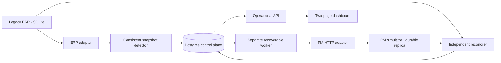

# Architecture and correctness boundaries

Invoice is ERP authoritative. Vendor is ERP-owned reference data. Job is PM reference data
only. These roles are deliberately not generalized into multi-master synchronization.

## Durable boundaries

1. Create IN_PROGRESS before a source read; one SQLite read transaction covers the dataset.
2. Record membership, COMPLETE status, observation versions, operations and queued jobs in
   one Postgres transaction. A failed source read only records FAILED and an audit event.
3. Retain the five latest COMPLETE snapshots plus any explicitly retained snapshot.
4. Create stable operation IDs and persist desired full state before external effects.
5. Claim jobs using `FOR UPDATE SKIP LOCKED`; a claim token guards queue completion. A
   short lease allows dead workers' jobs to become reclaimable.
6. A session advisory lock serializes local workers per logical record across HTTP writes.
   PM's database also rejects older versions and stores persistent delete fences.
7. Query the destination receipt and normalized current state before every attempted write.
   On uncertain outcomes, durable retry verifies the existing state first.
8. Applied versions and delete tombstones survive worker restarts. Queue delivery remains
   at least once; this is not an exactly-once message delivery claim.

The PM simulator stores data in its own `pm_sim` schema within the demo Postgres instance.
It uses different API shapes/IDs and a separate adapter, but shares database infrastructure
to keep the scaffold small. A future deployment can isolate it into another database.

Reconciliation uses a source-poller advisory lock and defers records with active operations.
Live edits to either external system can still race an independent read; a production-grade
classification contract and additional race tests belong to the proof milestone.

## Reference implementation sources

- [Postgres row locks and SKIP LOCKED](https://www.postgresql.org/docs/17/sql-select.html)
- [Psycopg transaction boundaries](https://www.psycopg.org/psycopg3/docs/basic/transactions.html)
- [FastAPI test client](https://fastapi.tiangolo.com/tutorial/testing/)

These support implementation choices; correctness claims require actual test evidence.
