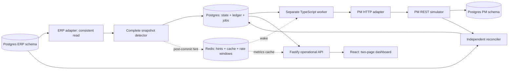

# TypeScript architecture

All durable demo schemas share one Postgres server while remaining separated by schema.
Invoice is ERP authoritative; Vendor is ERP-owned reference data; Job is PM validation data.
There is no live reverse Job path. Redis is disposable acceleration, not an operation ledger.

Full-state observations, ledger operations and queue jobs commit atomically. Workers claim
rows using SKIP LOCKED, use per-record session locks across external effects, verify uncertain
writes before retry and preserve applied versions/delete tombstones. PM independently
persists operation receipts and version fences.

Reconciliation defers active work and re-reads PM under the worker's record fence. Named
fault hooks require explicit opt-in on disposable CLI processes and are refused by the API.

On AWS, one EC2 instance runs Compose containers and Redis; private RDS stores all durable
state. IAM supplies access to the packaged source and generated DB secret. SSM handles
administration; nginx is the only HTTP ingress, restricted by CIDR.

Implementation references: [node-postgres transactions](https://node-postgres.com/features/transactions),
[Redis Node client](https://redis.io/docs/latest/develop/clients/nodejs/connect/),
[Vite setup](https://vite.dev/guide/), and [AWS CDK guide](https://docs.aws.amazon.com/cdk/v2/guide/home.html).
Correctness still requires the recorded acceptance tests, not just these building blocks.

The executable Failure Lab spawns fault-enabled child processes only in the explicitly
isolated demo configuration. Simulator fault settings and run evidence are durable. The
invoice ingress service records and freezes an untrusted extraction proposal, validates
references and uniqueness, and transactionally verifies the simulated ERP write. Accepted
own-write fingerprints are correlated while normal ERP-to-PM propagation remains enabled.
No new connector, bidirectional authority, or entity has been added.
